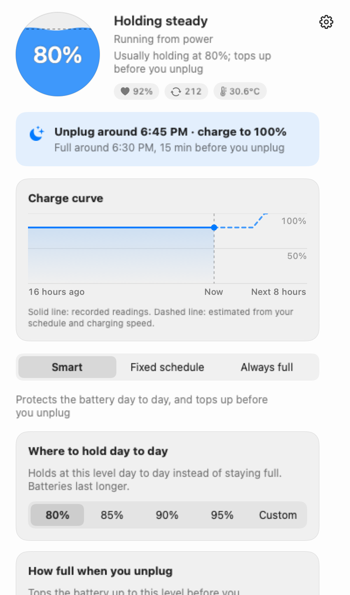
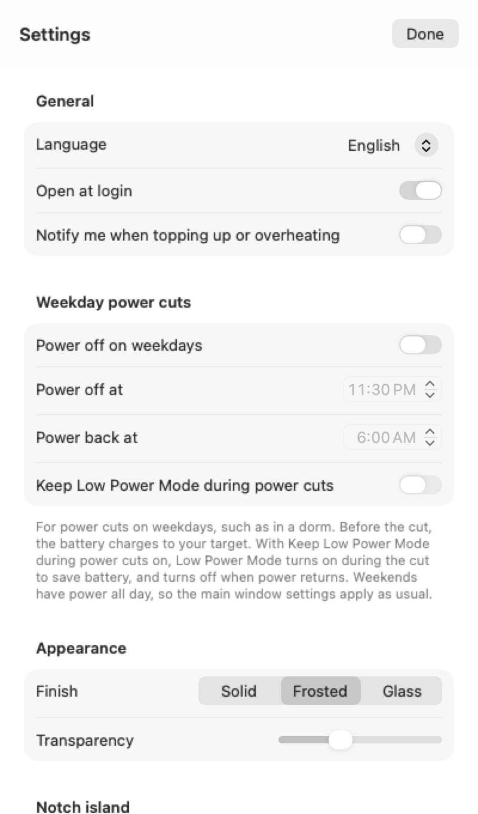

# Charge Limit

A small macOS menu bar app that keeps your MacBook's battery around 80% most of the time, then fills it up before you usually unplug. Works on Apple silicon and Intel. Free and open source.

English · [繁體中文](README.zh-Hant.md) · [简体中文](README.md)

<p align="center">
  
  
</p>

## Why

Lithium batteries wear fastest when they sit at 100%, and faster still when they're warm and full. Plenty of MacBooks spend most of the day plugged in at 100%. macOS's Optimized Battery Charging holds back the last stretch too, but the system decides when and for how long, and you can't change it.

This app does one thing: hold the battery at a level you choose, and top it up shortly before you usually head out.

## Download

Get the latest build from [Releases](https://github.com/1837620622/MacFullBar/releases) and pick the one for your chip:

- Apple silicon: `MacBatteryCharge-<version>-arm64.dmg` or `.pkg`
- Intel: `MacBatteryCharge-<version>-intel.dmg` or `.pkg`

Open the DMG and drag Charge Limit into Applications, or double-click the PKG and follow along. Needs macOS 13 or later.

The app isn't notarized by Apple, so macOS will block it the first time you open it. Go to System Settings → Privacy & Security, scroll down, and click "Open Anyway".

## What it looks like

It sits in the menu bar as a small battery with the current percentage next to it. Click it and a window drops down. Top left is the charge level, and next to it is what the app is doing right now, for example "Holding steady, running from power". Under that is a row with battery health, cycle count and temperature; any of them turns orange when it's worth a look. Further down you'll see tonight's plan (when you usually unplug and roughly when it'll be full) and a chart of the last 16 hours.

The middle of the window is where you pick one of three modes.

**Smart** (the default). Holds at 80% day to day. You can change that to 85, 90 or 95, or type in your own number. It learns when you usually unplug and tops up to 100% before then (or just 80 or 90 if you prefer). It works out when to start from how fast this particular Mac charges, so it's usually full about 15 minutes before you leave.

**Fixed schedule**. Split the day into blocks and give each one a limit, say 80% during the day and 100% overnight. Time outside any block charges to 100%. You can also set a "Fill up before you unplug" time.

**Always full**. Charges to 100% whenever it's plugged in. Good for a laptop that lives on a desk.

All three behave the same when it's hot: once the battery reaches 35°C it holds at 80% until it cools to 33°C.

If you need a full battery right now, click "Top up" at the bottom of the window. It goes back to your usual setting when you unplug (in Fixed schedule, when the current block ends).

When something needs explaining, an extra line shows up in the window: the charger is too weak and the battery is draining while plugged in, or the battery is above the limit and the app is only pausing charging rather than draining it.

## How it learns your routine

The first time each day that you've been plugged in for more than 30 minutes and then unplug counts once. When three of those land within the same hour, it treats that as your usual unplug time and starts topping up ahead of it. Unplugging for a minute to move rooms doesn't count.

Until then it uses the time you entered during setup (11:30 PM by default). Everything it learns stays on this Mac. To start over, open "Habits and details" and click "Learn again". To stop it learning, turn off "Remember my charging habits".

## Weekday power cuts

If your power goes off on weekday nights (common in some dorms), open Settings → Weekday power cuts and enter when the power goes off and comes back (11:30 PM to 6:00 AM by default). Monday to Friday it charges to your "How full when you unplug" level before the cut. Weekends are left alone.

To save power during the cut, tick "Keep Low Power Mode during power cuts". The app turns on macOS Low Power Mode during the cut and turns it off when power returns. It's off by default. It only turns off what it turned on: if you had already switched Low Power Mode on yourself, it leaves it be, and if the Mac restarted in the middle of the cut, it still turns it off afterwards. This needs the discharge helper.

## Discharge helper (optional)

macOS's charge limit can only stop charging. It can't drain the battery. If the battery is at 90% and you set the limit to 80%, it just sits at 90% until you use it down.

The discharge helper is a small program that runs as root. It can disconnect the power adapter for a while so the Mac runs on battery, then reconnect it once the battery reaches the limit. It also handles Low Power Mode during power cuts, and on Macs where macOS can't set a limit (Intel, for example) it's what stops charging.

Install it from Settings → Advanced. macOS asks for your administrator password once; the password never passes through this app. It only discharges during blocks of your Fixed schedule where you turned on "Discharging", and only when the battery is at least 3% above the limit, above 20%, and the temperature can be read. Click "No discharge today" to skip a day. It doesn't discharge while the Mac is asleep, and if the app quits or goes quiet for two minutes, the helper reconnects power on its own. You can remove it from the same place; it reconnects power before it goes.

## Updates

About every six hours the app checks whether there's a new version (you can turn this off in Settings). When there is one, a banner appears at the top of the window. "Download New Version" opens the installer for your chip in your browser, and you install it yourself. Once it's installed, the copy that's running reopens itself within about fifteen seconds, with your settings and history intact.

If you install over the old version with the DMG, the discharge helper stays on the old version, so reinstall it in Settings → Advanced. The PKG replaces it for you.

## Privacy

Reading the battery and setting the limit need no special permissions and no password (except for installing the discharge helper). No Full Disk Access, Accessibility, Screen Recording or Input Monitoring; the notch island only uses the mouse position and clicks. There's no account and no battery data leaves your Mac. The only place the app contacts on its own is GitHub, to check the latest version number.

Settings and history live in `~/Library/Application Support/MacBatteryCharge`. "Open data folder" in Settings takes you there.

## Known issues

- Topping up ahead of time is an estimate. If you unplug earlier than usual, or charging is slower than usual (a smaller charger, say), it may not be full in time. When the battery is too hot it only goes to 80%.
- Apple's own charge limit isn't exact. It can be a few percent off and occasionally charges to 100%. The app can't change that.
- On a few Macs with newer firmware, macOS won't let anyone change the limit and the discharge helper can't either. The window says so plainly instead of pretending to work.
- It hasn't been tested on every Mac. If something goes wrong, use Settings → About → "Report an issue". It opens a new GitHub issue with the version, macOS version and recent log lines filled in (your home folder replaced with `~`), so you can read it before you send it.

## Uninstall

If you installed the discharge helper, remove it first in Settings → Advanced. Then turn off "Open at login", quit the app, and drag Charge Limit from Applications to the Trash. To delete its records too, remove `~/Library/Application Support/MacBatteryCharge`. The system charge limit stays at the last value the app set; if System Settings has a charge limit option on your Mac, you can set it back to 100% there.

## Building

```bash
swift test                                              # logic tests, no hardware needed
bash packaging/build.sh                                 # build for both chips, make the PKG and DMG
.build/release/MacBatteryCharge --snapshot snapshots    # render UI screenshots from sample data
```

Design notes (in Chinese): [设计要求](docs/设计要求.md), [设计核对](docs/设计核对.md), [界面](docs/界面.md), [调研](docs/调研.md). What changed in each version: [CHANGELOG](CHANGELOG.md).

## Sponsorship

Every feature is free, and it will stay free for individuals. If it's useful to you, you're welcome to chip in any amount; it doesn't unlock anything. For company sponsorship, custom work or support, see [enterprise cooperation](docs/企业合作.en.md). Payments aren't set up yet, so for now open an issue at [Issues](https://github.com/1837620622/MacFullBar/issues/new/choose) titled "Sponsorship" or "Enterprise cooperation".

## Thanks

[Calma](https://github.com/Milanpatel35/calma) and [batt](https://github.com/charlie0129/batt) published the research and ideas this builds on.

## License

GNU GPL-3.0, see [LICENSE](LICENSE). © 2026 传康Kk.
