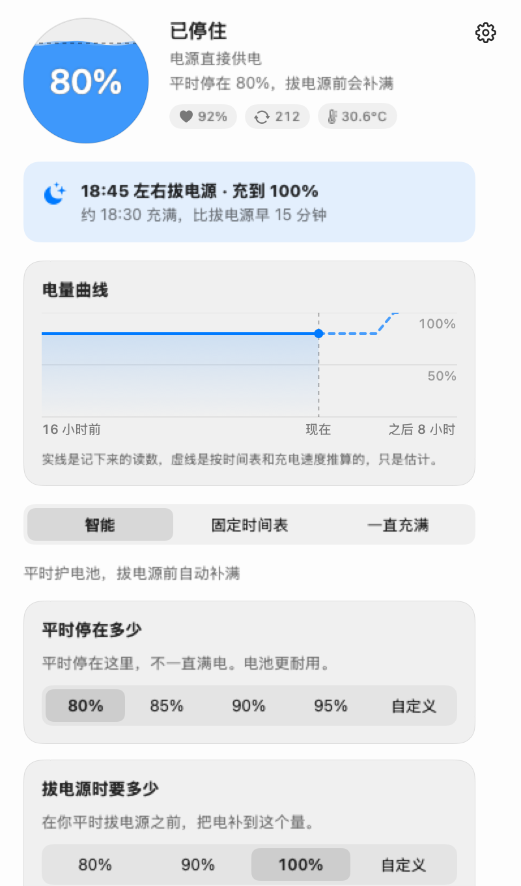
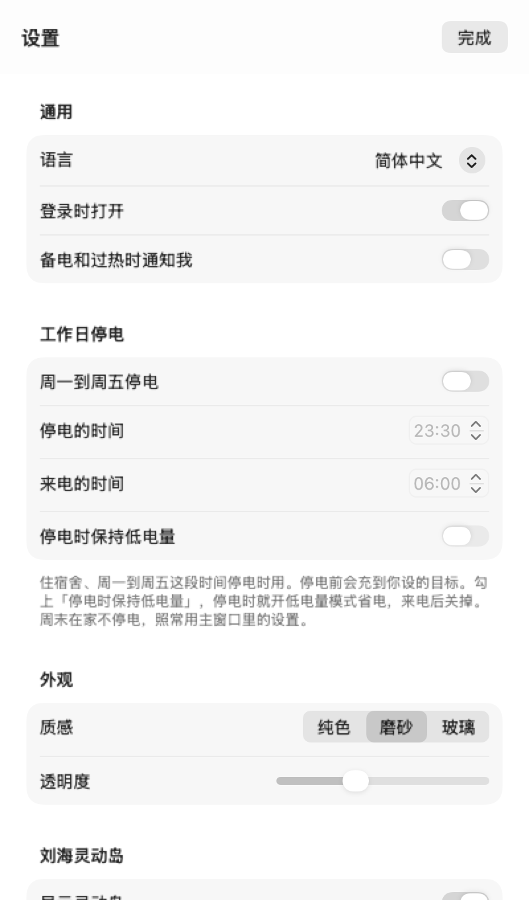

# 充电上限

一个 macOS 菜单栏小工具：平时让 MacBook 的电池停在 80% 左右，到你平时拔电源之前再把它充满。免费，开源。

[English](README.en.md) · [繁體中文](README.zh-Hant.md) · 简体中文

<p align="center">
  
  
</p>

## 为什么要它

锂电池最怕的是长时间挂在满电，又热又满的时候更伤。很多 MacBook 一天大半时间插着电源，电量就一直停在 100%。macOS 自带的「优化电池充电」也会推迟充满，但什么时候推迟、推迟到几点由系统说了算，你改不了。

这个软件做的事很直接：平时停在你定的数字，快到你平时拔电源的时间，提前把电补上。

## 下载和安装

到 [Releases](https://github.com/1837620622/MacFullBar/releases) 下载最新版，按芯片选：

- Apple 芯片：`MacBatteryCharge-<版本>-arm64.dmg` 或 `.pkg`
- Intel：`MacBatteryCharge-<版本>-intel.dmg` 或 `.pkg`

DMG 打开后把「充电上限」拖进「应用程序」；PKG 双击，跟着提示装就行。需要 macOS 13 或更新的系统。

软件没有经过 Apple 公证，第一次打开会被系统拦下。到「系统设置 → 隐私与安全性」往下翻，点「仍要打开」。

## 用起来是什么样

它待在菜单栏，图标是一个小电池加上现在的电量。点一下弹出窗口：左上角是电量，旁边写着它现在在做什么，比如「已停住，电源直接供电」；下面一排小字是电池健康、循环次数和温度，哪一项该留意了会变成橙色。再往下是今晚的计划（几点拔电源、大概几点能充满）和过去 16 小时的电量曲线。

窗口中间选模式，一共三种。

**智能**（默认）。平时停在 80%，可以改成 85、90、95，也可以自己填一个数。它会记住你平时几点拔电源，在那之前把电补到 100%（也可以只补到 80 或 90）。什么时候开始补，是按这台机器实际的充电速度倒推的，一般在你拔电源前 15 分钟左右充满。

**固定时间表**。把一天分成几段，每段停在多少由你定，比如白天 80%、晚上 100%。没排到的时间按 100% 充。也可以设一个「拔电源前充满」的时间。

**一直充满**。接上电源就充到 100%，适合常年插着电当台式机用的。

三种模式都一样：电池到了 35°C 先停在 80%，降到 33°C 再接着充。

临时要满电，点窗口最下面的「临时充满」。拔掉电源就恢复原来的设置（固定时间表里是到这一段结束）。

充电器功率不够、插着电还在掉电，或者电量比上限高、只停充不往下放，窗口里会多一行提醒告诉你为什么。

## 它怎么学你的习惯

每天第一次插着电源超过 30 分钟、然后拔掉，记一次。一小时以内的记满 3 次，它就认定你平时大概这个点拔电源，之后按这个时间提前补电。白天挪个地方、插拔一下，不算。

学会之前，它按你在引导里填的时间来（默认 23:30）。记录只存在这台 Mac 上。想重新学，展开「习惯和细节」点「重新学习」；不想让它学，关掉「记住我的充电习惯」。

## 宿舍晚上断电

工作日晚上会停电的话，在「设置 → 工作日停电」里打开它，填上停电和来电的时间（默认 23:30 到早上 6:00）。周一到周五，它会在停电前把电充到「拔电源时要多少」那个数；周末照常。

停电的时候想省电，勾上「停电时保持低电量」，它会打开 macOS 的低电量模式，来电后关掉。这一项默认不勾。它只关自己开的那次：停电前你已经手动开了低电量模式，它不会去碰；中途重启了电脑，来电后也照样会关。低电量模式要用到放电帮手。

## 放电帮手（可选）

macOS 的充电上限只会「不再往上充」，不会「放掉一点」。电池已经在 90%，你把上限改成 80%，它只会停在 90%，等你慢慢用下来。

放电帮手是一个以 root 运行的小程序，可以暂时断开电源适配器，让电脑先用电池，降到上限再接回来。它还负责停电时的低电量模式；在系统设不了上限的机器上（比如 Intel），也由它来停止充电。

在「设置 → 高级」里安装，系统会问一次管理员密码，密码不经过这个软件。它只在固定时间表里开了「放电」的那几段放电，而且要电量比上限高 3% 以上、不低于 20%、读得到电池温度才开始。当天不想放，点「今天不放电」。电脑睡眠时它不放电；软件退出，或者两分钟没收到软件的消息，它会自己把电源接回去。不想要了在同一个地方卸载，卸载前会先把电源接回来。

## 更新

软件大约每 6 小时去查一次有没有新版本，设置里可以关掉。有新版本时窗口顶上会提示，点「下载新版本」会在浏览器里下载对应芯片的安装包，你自己打开装。装好以后，正在运行的旧版本十几秒内会自己重新打开，设置和记录都在。

用 DMG 覆盖安装后，放电帮手还是旧的，要去「设置 → 高级」重新装一次；PKG 会顺手把它换掉。

## 隐私

读电池、设上限都不需要额外授权，也不要密码（放电帮手除外）。不需要完全磁盘访问、辅助功能、屏幕录制或输入监控，刘海灵动岛只用到鼠标位置和点击。没有账号，不上传任何电池数据。软件自己只会联系一个地方：GitHub，查最新的版本号。

设置和记录都在 `~/Library/Application Support/MacBatteryCharge`，设置里的「打开数据文件夹」可以直接打开。

## 已知的问题

- 提前补电是估出来的。比平时早拔电源，或者充得比平时慢（比如换了小功率充电器），到点可能还没满。电池过热时也只会到 80%。
- 苹果自己的充电上限不太准，会差几个百分点，偶尔还会充到 100%，这一点软件改不了。
- 少数新固件的机器，系统不让改上限，放电帮手也改不了。遇到这种情况，窗口里会直接写出来，不会装作在工作。
- 没办法在每一台 Mac 上都测过。遇到问题，用「设置 → 关于 → 反馈问题」提交，它会在 GitHub 上新建一条 issue，填好版本、系统和最近的日志（用户目录换成了 `~`），你看过再发。

## 卸载

装过放电帮手的话，先在「设置 → 高级」里卸载它。再关掉「登录时打开」，退出软件，把「充电上限」从「应用程序」拖进废纸篓。想连记录一起删，删掉 `~/Library/Application Support/MacBatteryCharge`。系统的充电上限会留在最后一次设的值，系统设置里有「充电上限」的话，可以在那里改回 100%。

## 自己编译

```bash
swift test                                              # 逻辑测试，不碰硬件
bash packaging/build.sh                                 # 编两种芯片，打 PKG 和 DMG
.build/release/MacBatteryCharge --snapshot snapshots    # 用假数据画出界面截图
```

设计文档：[设计要求](docs/设计要求.md)、[设计核对](docs/设计核对.md)、[界面](docs/界面.md)、[调研](docs/调研.md)。每一版改了什么见 [CHANGELOG](CHANGELOG.md)。

## 赞助

所有功能都免费，以后也不会对个人收费。觉得有用可以赞助，多少都行，不影响任何功能。公司想赞助、定制或者要技术支持，看[企业合作](docs/企业合作.md)。收款方式还没开通，可以先在 [Issues](https://github.com/1837620622/MacFullBar/issues/new/choose) 开一条，标题写「赞助」或「企业合作」。

## 致谢

[Calma](https://github.com/Milanpatel35/calma) 和 [batt](https://github.com/charlie0129/batt) 公开的资料和思路帮了很大的忙。

## 许可证

GNU GPL-3.0，见 [LICENSE](LICENSE)。© 2026 传康Kk。
