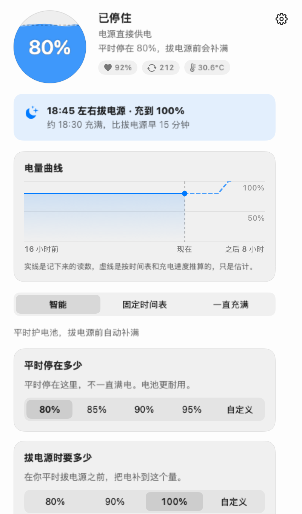
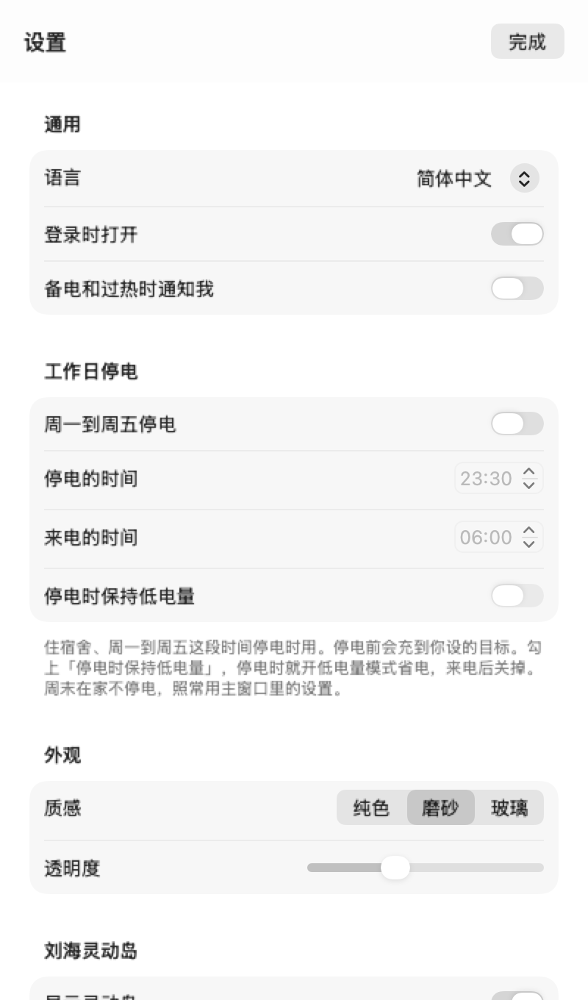

# 充電上限

一個 macOS 選單列小工具：平時讓 MacBook 的電池停在 80% 左右，到你平時拔電源之前再把它充滿。免費，開源。

[English](README.en.md) · 繁體中文 · [简体中文](README.md)

<p align="center">
  
  
</p>

## 為什麼要它

鋰電池最怕長時間掛在滿電，又熱又滿的時候更傷。很多 MacBook 一天大半時間插著電源，電量就一直停在 100%。macOS 內建的「最佳化電池充電」也會延後充滿，但什麼時候延後、延後到幾點由系統決定，你改不了。

這個軟體做的事很直接：平時停在你定的數字，快到你平時拔電源的時間，提前把電補上。

## 下載和安裝

到 [Releases](https://github.com/1837620622/MacFullBar/releases) 下載最新版，按晶片選：

- Apple 晶片：`MacBatteryCharge-<版本>-arm64.dmg` 或 `.pkg`
- Intel：`MacBatteryCharge-<版本>-intel.dmg` 或 `.pkg`

DMG 打開後把「充電上限」拖進「應用程式」；PKG 點兩下，跟著提示裝就好。需要 macOS 13 或更新的系統。

軟體沒有經過 Apple 公證，第一次打開會被系統擋下。到「系統設定 → 隱私權與安全性」往下捲，點「仍要打開」。

## 用起來是什麼樣子

它待在選單列，圖示是一個小電池加上現在的電量。點一下彈出視窗：左上角是電量，旁邊寫著它現在在做什麼，例如「已停住，電源直接供電」；下面一排小字是電池健康度、循環次數和溫度，哪一項該留意了會變成橘色。再往下是今晚的計畫（幾點拔電源、大概幾點能充滿）和過去 16 小時的電量曲線。

視窗中間選模式，一共三種。

**智慧**（預設）。平時停在 80%，可以改成 85、90、95，也可以自己填一個數字。它會記住你平時幾點拔電源，在那之前把電補到 100%（也可以只補到 80 或 90）。什麼時候開始補，是按這台機器實際的充電速度倒推的，一般在你拔電源前 15 分鐘左右充滿。

**固定時間表**。把一天分成幾段，每段停在多少由你定，例如白天 80%、晚上 100%。沒排到的時間按 100% 充。也可以設一個「拔電源前充滿」的時間。

**一直充滿**。接上電源就充到 100%，適合常年插著電當桌機用的。

三種模式都一樣：電池到了 35°C 先停在 80%，降到 33°C 再繼續充。

臨時要滿電，點視窗最下面的「臨時充滿」。拔掉電源就恢復原本的設定（固定時間表裡是到這一段結束）。

充電器功率不夠、插著電還在掉電，或者電量比上限高、只停充不往下放，視窗裡會多一行提醒告訴你為什麼。

## 它怎麼學你的習慣

每天第一次插著電源超過 30 分鐘、然後拔掉，記一次。一小時以內的記滿 3 次，它就認定你平時大概這個時間拔電源，之後按這個時間提前補電。白天換個位置、插拔一下，不算。

學會之前，它按你在引導裡填的時間來（預設 23:30）。紀錄只存在這台 Mac 上。想重新學，展開「習慣和細節」點「重新學習」；不想讓它學，關掉「記住我的充電習慣」。

## 宿舍晚上斷電

工作日晚上會停電的話，在「設定 → 工作日停電」裡打開它，填上停電和來電的時間（預設 23:30 到早上 6:00）。週一到週五，它會在停電前把電充到「拔電源時要多少」那個數字；週末照常。

停電的時候想省電，勾選「停電時保持低電量」，它會打開 macOS 的低電量模式，來電後關掉。這一項預設不勾。它只關自己開的那次：停電前你已經手動開了低電量模式，它不會去碰；中途重新開機了，來電後也照樣會關。低電量模式要用到放電幫手。

## 放電幫手（選用）

macOS 的充電上限只會「不再往上充」，不會「放掉一點」。電池已經在 90%，你把上限改成 80%，它只會停在 90%，等你慢慢用下來。

放電幫手是一個以 root 執行的小程式，可以暫時斷開電源轉接器，讓電腦先用電池，降到上限再接回來。它也負責停電時的低電量模式；在系統設不了上限的機器上（例如 Intel），也由它來停止充電。

在「設定 → 進階」裡安裝，系統會問一次管理者密碼，密碼不經過這個軟體。它只在固定時間表裡開了「放電」的那幾段放電，而且要電量比上限高 3% 以上、不低於 20%、讀得到電池溫度才開始。當天不想放，點「今天不放電」。電腦睡眠時它不放電；軟體結束，或者兩分鐘沒收到軟體的訊息，它會自己把電源接回去。不想要了在同一個地方解除安裝，解除安裝前會先把電源接回來。

## 更新

軟體大約每 6 小時查一次有沒有新版本，設定裡可以關掉。有新版本時視窗頂端會提示，點「下載新版本」會在瀏覽器裡下載對應晶片的安裝檔，你自己打開安裝。裝好以後，正在執行的舊版本十幾秒內會自己重新打開，設定和紀錄都在。

用 DMG 覆蓋安裝後，放電幫手還是舊的，要到「設定 → 進階」重新裝一次；PKG 會順手把它換掉。

## 隱私

讀電池、設上限都不需要額外授權，也不用密碼（放電幫手除外）。不需要完整磁碟取用權限、輔助使用、螢幕錄製或輸入監控，劉海靈動島只用到滑鼠位置和點擊。沒有帳號，不上傳任何電池資料。軟體自己只會連到一個地方：GitHub，查最新的版本號。

設定和紀錄都在 `~/Library/Application Support/MacBatteryCharge`，設定裡的「在 Finder 中顯示資料」可以直接打開。

## 已知的問題

- 提前補電是估出來的。比平時早拔電源，或者充得比平時慢（例如換了小功率充電器），到點可能還沒滿。電池過熱時也只會到 80%。
- 蘋果自己的充電上限不太準，會差幾個百分點，偶爾還會充到 100%，這一點軟體改不了。
- 少數新韌體的機器，系統不讓改上限，放電幫手也改不了。遇到這種情況，視窗裡會直接寫出來，不會裝作在運作。
- 沒辦法在每一台 Mac 上都測過。遇到問題，用「設定 → 關於 → 回報問題」送出，它會在 GitHub 上新開一則 issue，填好版本、系統和最近的日誌（使用者目錄換成了 `~`），你看過再送出。

## 解除安裝

裝過放電幫手的話，先在「設定 → 進階」裡解除安裝它。再關掉「登入時開啟」，結束軟體，把「充電上限」從「應用程式」拖到垃圾桶。想連紀錄一起刪，刪掉 `~/Library/Application Support/MacBatteryCharge`。系統的充電上限會留在最後一次設定的值，系統設定裡有「充電上限」的話，可以在那裡改回 100%。

## 自己編譯

```bash
swift test                                              # 邏輯測試，不碰硬體
bash packaging/build.sh                                 # 編兩種晶片，打包 PKG 和 DMG
.build/release/MacBatteryCharge --snapshot snapshots    # 用假資料畫出介面截圖
```

設計文件（簡體中文）：[設計要求](docs/设计要求.md)、[設計核對](docs/设计核对.md)、[介面](docs/界面.md)、[調研](docs/调研.md)。每一版改了什麼見 [CHANGELOG](CHANGELOG.md)。

## 贊助

所有功能都免費，以後也不會對個人收費。覺得有用可以贊助，多少都可以，不影響任何功能。公司想贊助、客製或者要技術支援，看[企業合作](docs/企業合作.zh-Hant.md)。收款方式還沒開通，可以先在 [Issues](https://github.com/1837620622/MacFullBar/issues/new/choose) 開一則，標題寫「贊助」或「企業合作」。

## 致謝

[Calma](https://github.com/Milanpatel35/calma) 和 [batt](https://github.com/charlie0129/batt) 公開的資料和思路幫了很大的忙。

## 授權

GNU GPL-3.0，見 [LICENSE](LICENSE)。© 2026 傳康Kk。
